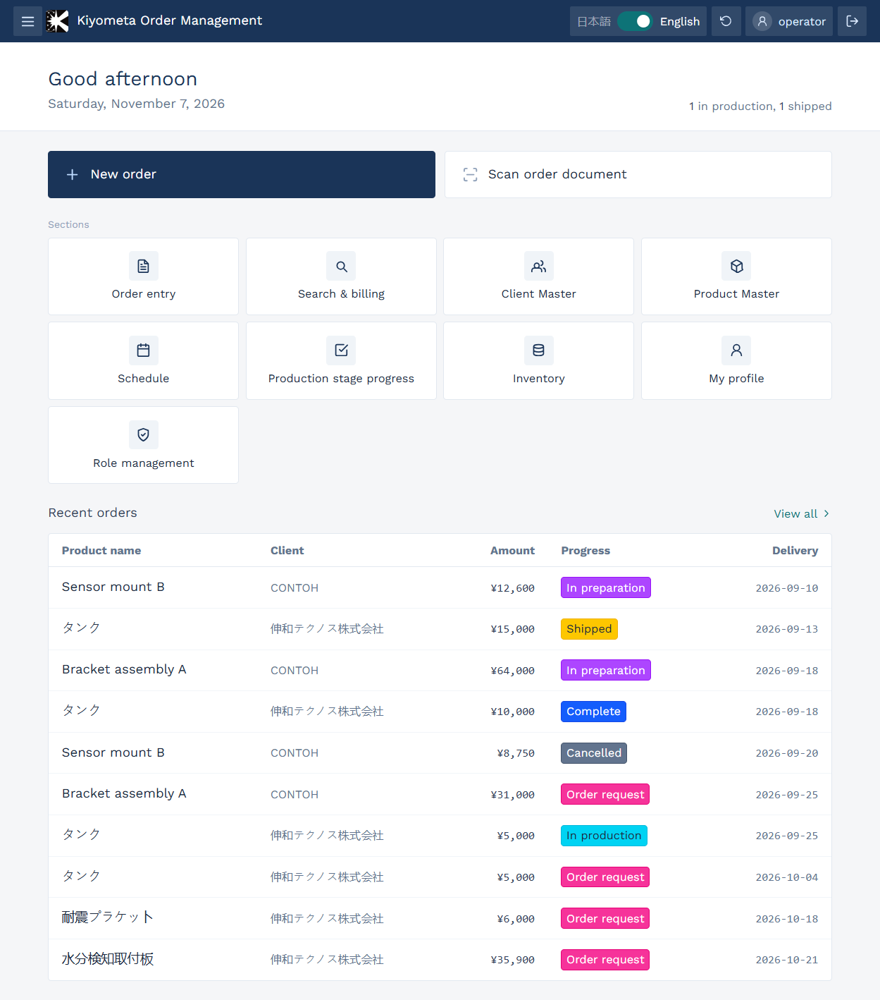
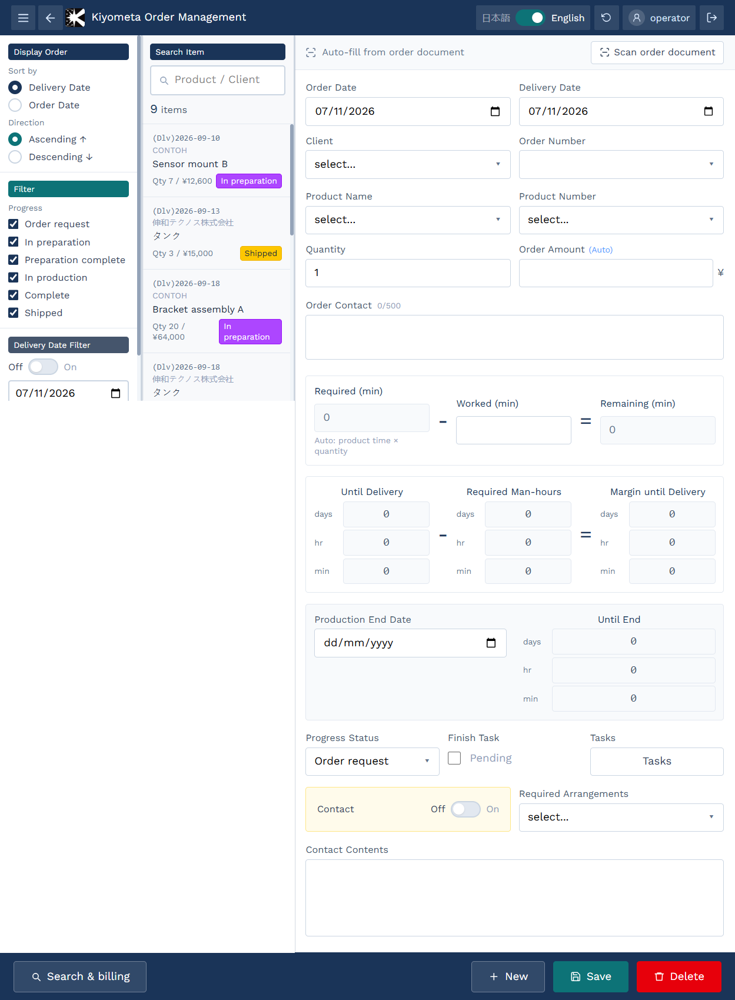
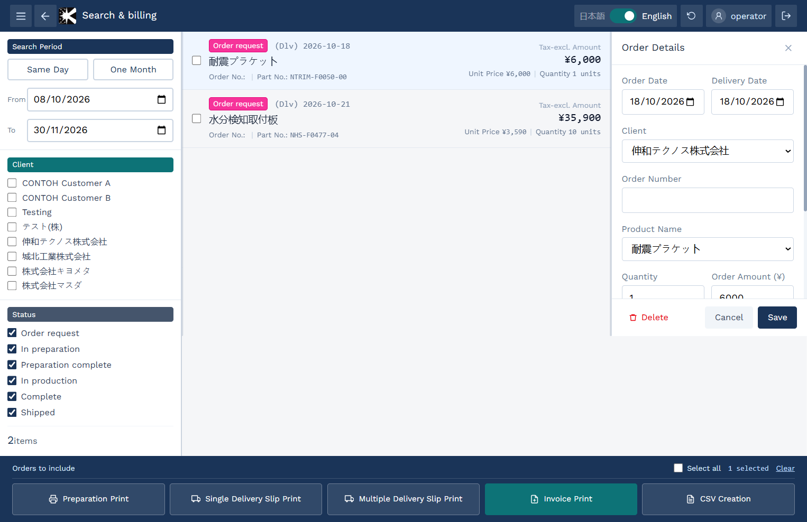
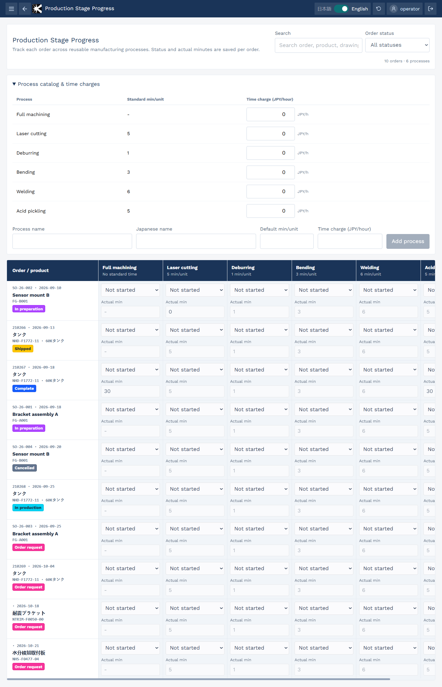
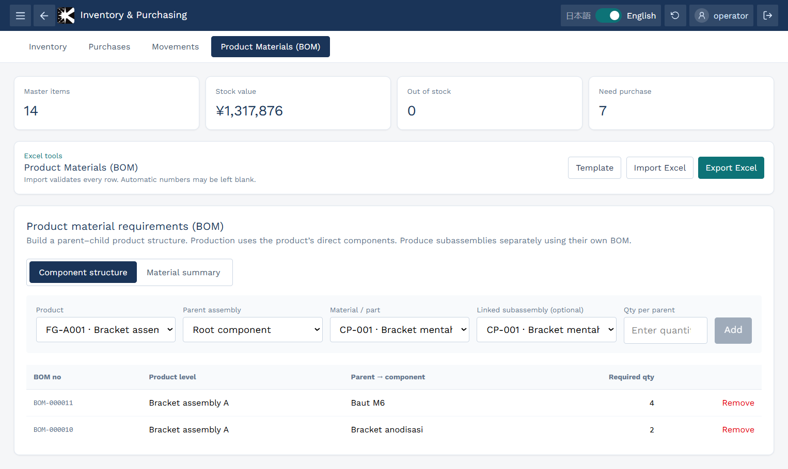

# Kiyometa Order Management

Kiyometa is a web-based manufacturing management application for a Japanese steel manufacturer. It replaces legacy tablet software and keeps quotation, order, production, bill of materials (BOM), and inventory data in one system across multiple tablets.

The application provides workflows for quotation and order entry, production scheduling, BOM management, and inventory management. Inventory covers material receipts, stock movements, and stock reconciliation when an order changes status.

The OCR service uses Python, FastAPI, RapidOCR, and OpenCV to read quotation details from customer documents. Staff can crop or rotate an image, then correct extracted fields before they enter an order.

The app supports offline order recovery through IndexedDB. It saves drafts, resumes OCR jobs, and queues submissions. Version checks help resolve edits made on more than one device.

## Screenshots

### Home

### Order Entry

### Search & Billing

### Production Stage Progress

### Inventory & Purchasing

## Technology

React, TypeScript, and Vite run the web app. Supabase provides authentication, PostgreSQL data, file storage, and Edge Functions. FastAPI runs the OCR service. Flutter provides the Android tablet app.

## Project folders

- `webapp/` contains the React application.
- `backend/supabase/migrations/` contains the database schema changes.
- `backend/supabase/functions/` contains Supabase Edge Functions.
- `ocr-service/` contains the Python OCR service.
- `lib/`, `android/`, and `web/` contain the Flutter application.

## Run the web app

1. Install Node.js.
2. Copy `webapp/.env.local.example` to `webapp/.env.local`.
3. Set `VITE_SUPABASE_URL` and `VITE_SUPABASE_PUBLISHABLE_KEY` in `webapp/.env.local`.
4. Open a terminal in `webapp/`.
5. Run `npm ci`.
6. Run `npm run dev`.

The publishable key is for browser use. Do not put a database password or a service role key in this file.

## Database setup

The SQL files in `backend/supabase/migrations/` define the database structure and access rules. They do not add sample customer records. Apply them in number order to a new Supabase project. Deploy the `manage-users` function after applying the migrations.
